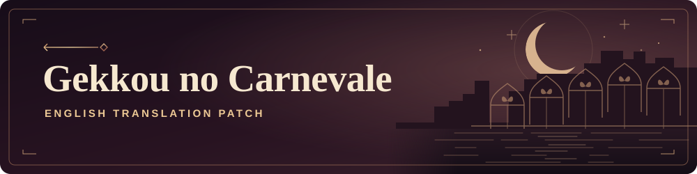

  

# Gekkou no Carnevale English Patch

A complete English retranslation of **Gekkou no Carnevale** (月光のカルネヴァーレ), Nitroplus’s original Japanese visual novel for Windows. **v1.0** is the first public release.

  

[Installation](#installation) · [Existing saves](#existing-saves) · [Opening subtitles](#opening-subtitles) · [Report an issue](https://github.com/Dern00/gekkou-no-carnevale-english-patch/issues)

## Features

- A new translation from the Japanese v1.01 script covering all routes, choices, and endings.
- English menus, settings, interface artwork, and the all-endings card.
- English word wrapping, taller boxes for long passages, and ruby readings in both the story and the backlog.
- A remembered **Stop voice on click** option in **Settings → Text**. Turn it off to let voices finish over narration, or on to cut the current voice when you advance.
- The September 2026 crash fix for Windows menu input.
- A folder-picker installer with verified backups and a restore option.

## Requirements

- The original Japanese Windows release from Nitroplus, either v1.00 or with the official v1.01 update.
- A Windows environment that can already launch your copy of the Japanese game. The patch was tested on Windows 11. [Nitroplus’s support page](https://www.nitroplus.co.jp/support/sp12/) covers the original game.

## Installation

1. Close the game and back up your saves.
2. Download **Gekkou_no_Carnevale_English_Patch_v1.0.zip** from [Releases](https://github.com/Dern00/gekkou-no-carnevale-english-patch/releases/tag/v1.0). Extract the entire ZIP outside the game folder.
3. Run **Gekkou no Carnevale English Patch.exe**. Select **GekkounoCarnevale.exe** in the game folder and click **Install patch**.
4. Launch **GekkounoCarnevale.exe** from that folder.

The installer applies Nitroplus’s official v1.01 files when it detects a supported v1.00 installation. It downloads the verified updater from Nitroplus as part of installation. If the download fails, place the official **Carnevale101.EXE** beside the patch installer and try again. An already-updated v1.01 copy can be patched offline. [Official v1.01 download](https://www.nitroplus.co.jp/support/sp12/374.php).

The release ZIP contains the playable patch. GitHub’s **Code → Download ZIP** gives you the repository files.

## Existing saves

A new game gives you a clean English backlog. An existing save can retain the text that was on screen when it was made, along with older backlog entries. The engine fixes the textbox dimensions on older saves that use the six reassigned layouts. Loading and advancing from selected older saves was tested. If a save has trouble resuming, keep it and try starting from an earlier point.

## Opening subtitles

The optional local helper uses **Subtitled Opening.m4v** from Project 5’s December 2020 translation extras. It converts the picture to the format the game expects, pairs it with the game’s original soundtrack, and verifies the backup before replacing the movie. You’ll need that M4V and FFmpeg. [Opening subtitle instructions](OPENING-SUBTITLES.md).

## Removing the patch

Close the game, run the installer, select the same game folder, and click **Restore original files**. Keep the **Before Carnevale combined patch** folder until you no longer need to restore your files. The optional opening helper has its own restore command.

## Feedback and verification

If you report a bug, include the patch version, the surrounding dialogue or menu, and steps to reproduce it. A screenshot is helpful. Mention whether it happened after loading an existing save. [Open an issue](https://github.com/Dern00/gekkou-no-carnevale-english-patch/issues).

The release includes a SHA-256 checksum for the ZIP. This repository contains the installer and optional opening helper sources, documentation, and the release checksum. [Validation](VALIDATION.md).

## Credits

Original game, story, artwork, music, and branding by **Nitroplus** and their respective creators. This is an unofficial fan translation. The optional opening helper supports subtitles from **Project 5**. [Original game page](https://www.nitroplus.co.jp/game/12-carnevale/).
